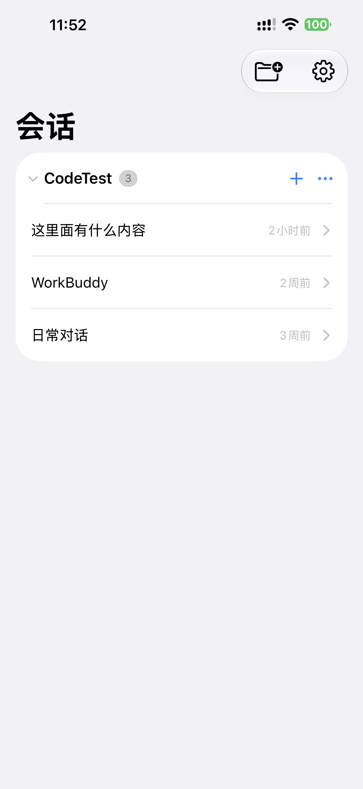
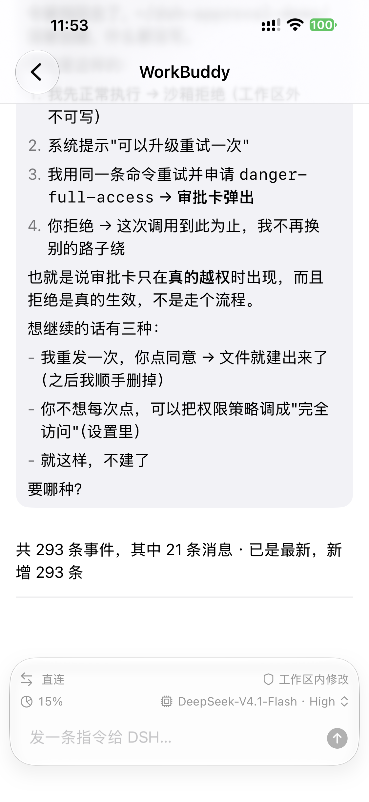
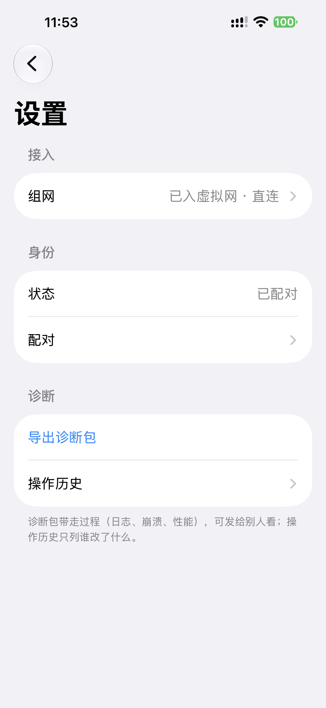
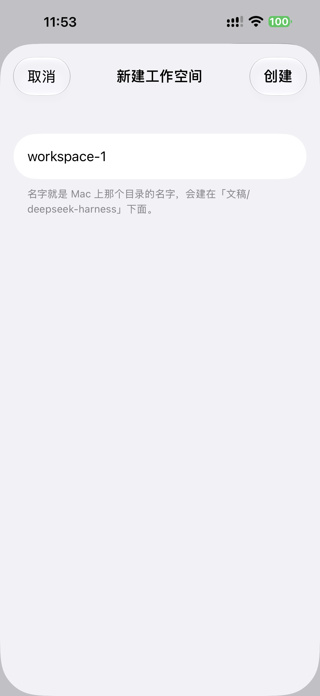

# dsh-mobile

把 [DeepSeek Harness](https://github.com/deepseek-ai/deepseek-harness)（`dsh`）的会话带到 iPhone 上。

dsh 是一个开源的 AI 智能体框架，通常运行在一台常开的机器上。dsh-mobile 让这台机器上的会话、消息与审批可以直接在手机上处理：使用者不必留在机器前，也不必与它处于同一个局域网。

两端之间通过 Tailscale 虚拟网络通信。通往开发机的路径因此是稳定的，与所处的 Wi-Fi 无关。

## 界面

| 会话总览 | 会话内协作 |
|---|---|
|  |  |
| 会话按工作空间分组，附最近活动时间与新建入口 | 消息流、工具调用过程与审批卡；底栏集中链路、用量、权限与模型 |
| **接入与诊断** | **新建工作空间** |
|  |  |
| 组网、身份、诊断三组设置，并显示当前接入方式 | 输入名称即在开发机上建立对应的工作空间目录 |

## 功能

### 会话总览

- 会话按工作空间分组，组头显示会话数量与展开状态，行尾显示最近活动时间。
- 顶部的新建入口用于创建工作空间；会话由各工作空间标题行的按钮新建，建在该工作空间之下。
- 连接状态条并非常驻：正常直连时不出现，仅在断线、重连等需要使用者知晓的情况下显示。

### 会话内协作

- 消息流由事件流合并而成，按对话顺序呈现；Markdown 内容按语义渲染，代码与强调保留原有结构。
- 工具调用与中间过程默认折叠，展开后可见完整过程，不干扰对结论的阅读。
- 回复以流式方式到达，界面随内容增长而更新；连接中断后自动重连。
- 底栏集中显示当前链路方式（直连或中继）、用量、权限档位与所选模型；点击用量与模型项可展开详情面板。
- 输入 `/` 唤起命令面板，列出可用于当前会话的操作。

### 审批

- 当一次调用超出当前权限档位时，界面以卡片形式给出该请求，由使用者批准或拒绝。
- 存在多个待审批请求时，除首张卡片外，其余折叠为一个入口，避免占满消息流。

### 模型与用量

- 可在会话内切换模型，并调整该模型的推理等级；选择结果立即作用于后续请求。
- 用量面板给出模型目录、上下文占用等信息，取不到时如实说明原因。

### 接入与身份

- **组网**：填写接入密钥与控制面信息后加入虚拟网络，设置页显示「已入虚拟网」以及直连或中继。
- **配对**：首次使用需输入网关启动日志中的六位配对码，有效期十分钟；配对完成后，该设备凭凭证访问，不再需要配对码。
- **解除**：撤销已配对设备后，手机的下一次请求将收到未授权响应，重新配对即可恢复。

### 诊断

- **导出诊断包**：打包日志、崩溃记录与性能数据，可经系统分享导出，用于排查问题或转交他人。
- **操作历史**：只记录谁改了什么，不含过程性的中间状态。

## 工作方式

```
iPhone（dsh-mobile）  ──Tailscale 虚拟网──▶  网关（dsh 插件）  ──▶  dsh
```

网关以插件形式运行在 dsh 进程内，对 tailnet 提供接口；手机经虚拟网络访问该地址，无需端口映射。两端以 JSON 信封交换请求与应答，并保留一条流式通道用于持续推送。

仓库的三个主要部分：

| 目录 | 内容 |
|---|---|
| `ios/` | iPhone 客户端 |
| `gateway/` | dsh 侧的网关插件 |
| `contract/` | 两端共同遵守的协议定义 |

## 快速开始

### 1. 开发机

```bash
git clone https://github.com/SuperJieLab/dsh-mobile.git
cd dsh-mobile
./install.sh
```

脚本把网关插件注册进 dsh 的 profile，并给出下一步。

此时 profile 依赖这份工作区（记的是一条指向它的链接）。若希望装完就与工作区无关，改用发布版：

```bash
./install.sh --from-release
```

它下载 latest release 上的网关包并安装，装进 profile 的是副本。

随后启动 dsh：

```bash
npx @deepseek-ai/dsh@alpha web
```

日志中出现 `[dsh-mobile-gateway] listening on …` 即表示网关就绪。

### 2. iPhone

用 Xcode 打开 `ios/DshMobile.xcodeproj`，选择目标设备后运行。

安装到自有设备前，需在 `ios/Config/Local.xcconfig` 中填写两项（模板见 `ios/Config/Shared.xcconfig`）：

```
APP_BUNDLE_ID = com.yourname.dshmobile
DEVELOPMENT_TEAM = <你的 Team ID>
```

未填写时仍可构建，但 bundle id 为占位值，无法安装到设备。

### 3. 首次连接

1. **组网**：在 Tailscale 后台创建接入密钥（`tskey-auth-…`），在 App 的「设置 → 组网」中填入密钥与网关地址。网关地址为该机在 tailnet 中的地址，形如 `http://100.x.y.z:3081`（`tailscale ip -4` 可查），不是局域网地址。
2. **配对**：在「设置 → 身份 → 配对」中输入网关日志里的六位配对码。

完成后返回会话列表，即可看到该机器上的会话。

解除全部已配对设备：

```bash
./install.sh --revoke
```

## 运行要求

| | |
|---|---|
| 开发机 | 常开，运行 dsh 与网关；macOS / Linux / Windows 均可，目前仅在 macOS 上实测 |
| iPhone | iOS 18.1 或更新 |
| 虚拟网络 | Tailscale 账号（免费额度足够），或自建 headscale |
| 构建工具 | Xcode 16 或更新 |

## 已知限制

- **仅支持以 Xcode 安装**：未提供 TestFlight 与 App Store 分发。
- **免费 Apple ID 签名的应用有效期七天**，到期需重新运行一次；付费开发者账号不受此限。
- **依赖虚拟网络**：客户端不提供局域网直连通路，网关地址须填写 tailnet 地址。
- **一个网关对应一台机器**，多台手机可同时连接，各自单独配对。
- **平台验证范围**：网关代码未引入平台相关假设（监听 `0.0.0.0`、路径基于用户主目录），Linux 与 Windows 理论上可用，但尚未实测。
